# Dithered stars

A night-sky look for the Claude apps: a sky shaded with an ordered pixel dither, stars drawn in text characters, and a sky that follows the real one: tonight's moon phase, meteor showers near their peak, the season's constellations, and a dusk, night or dawn tint by your clock.

### ✦ [Open the live preview](https://choco-mazapan.github.io/dithered-stars/)

The preview page is drawn by the theme's own code in your browser, so it shows tonight's actual sky. Deal a new pair of constellations, switch to the day version, still the motion, or pick any date to see another night's moon.

<a href="https://choco-mazapan.github.io/dithered-stars/"></a>

<details>
<summary>The day version (light mode)</summary>



</details>

## Install

At the prompt of a terminal session:

```
/plugin install dithered-stars --marketplace choco-mazapan/dithered-stars
```

Answer `y` to add the marketplace, then pick a scope.

From a shell:

```bash
claude plugin install dithered-stars --marketplace choco-mazapan/dithered-stars
```

In the desktop app, where `/plugin` does not run: click + next to the prompt box, then Plugins, Add marketplace with `choco-mazapan/dithered-stars`, then Add plugin.

## What it does

**The sky** (desktop and mobile apps)
- The moon in its real phase, lit on the correct side.
- More meteors in the margins within two days of a major shower's peak (Quadrantids, Lyrids, Perseids, Leonids, Geminids and more).
- A plum dusk, deep night and blue dawn by your local time; the sky rechecks every ten minutes.
- Two real constellations each session, picked from those up in the evening that month, plus the Pleiades in their season.
- Twinkling and flaring ASCII stars, shooting stars, pine hills with fireflies, and a lighthouse whose beam sweeps behind the tower and back across its front.
- The margins' meteors follow your usage: the more of your tightest rate limit (or, with none, your context window) the session has spent, the more stars fall, and the faster.
- In light mode, a pale day sky with clouds and a daytime moon.
- Panels are night-sky ink at 62% opacity with no blur, so the pixels stay sharp behind the words.

**The chat**
- A star after the thinking word (✦ while thinking); in the terminal the word becomes "Stargazing" and friends.
- A star on each tool call's row: white while it runs, gold when done, a red × on error.
- The prompt hint shows the moon and the next shower (terminal).
- Nord code colors at night, GitHub Light by day.

**Alerts**
- A soft chime when a turn runs longer than a minute.
- A toast when tests pass or `gh pr create` opens a pull request.
- A warning when a usage limit passes 80%, and again at 95%.

**The night watch pane and commands**
- `/night` opens a pane with the session, context window, usage and limits, a star clock, the tool-call log and quick actions. `/night usage` prints the figures.
- `/sky` tells tonight's constellations, moon and shower; `/sky new` deals a new pair.
- `/stars on|off` switches the terminal star band; `/stars quiet` stills every motion, `/stars lively` brings it back.
- In the terminal, a row of twinkling stars sits above the prompt, and the status line shows branch, model, context and the tightest limit.

All motion is CSS inside the scene, and it stops when your system asks for reduced motion. Seasons and the moon's lit side assume the northern hemisphere.
